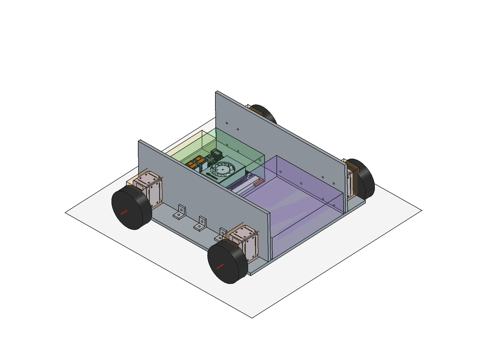
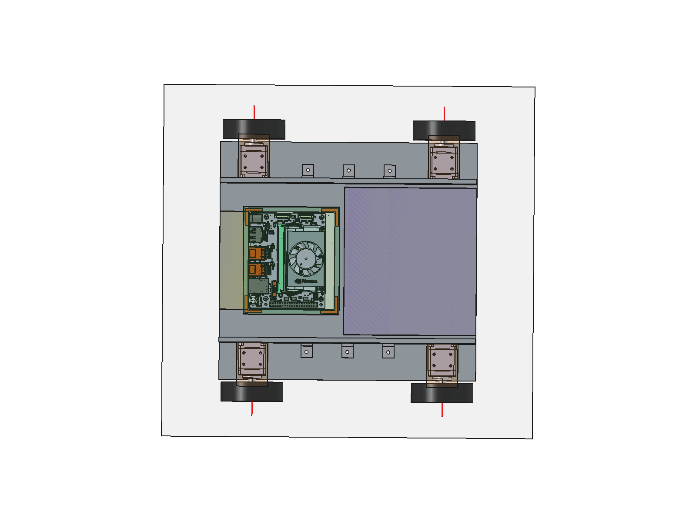
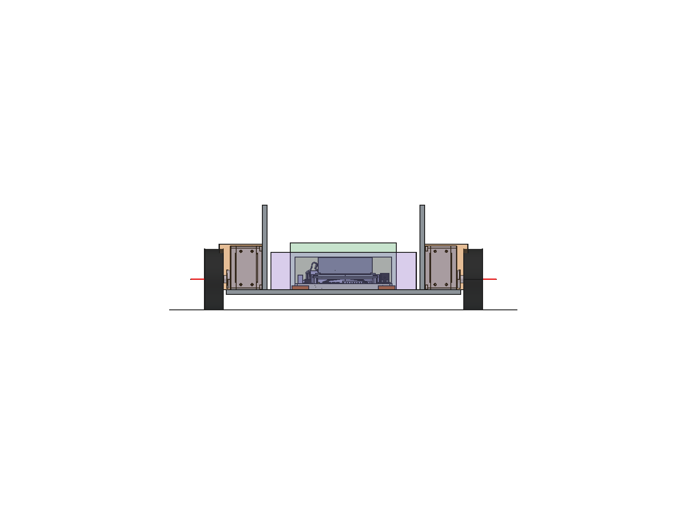

# TeamRobot 밑판 설계 작업 정리 (2026-10-15)

> 내일 이어서 작업하기 위한 기록. 최신 모델은 **v5**.
> 모든 치수 단위는 mm. 좌표는 조립 좌표계 기준 (아래 2절).



| 위에서 본 모습 | 앞(+X)에서 본 모습 |
|---|---|
|  |  |

---

## 0. 한눈에 보기

- 최신 조립 파일: `TeamRobot/Assembly/TeamRobot_Base_v5_Assembly.FCStd`
- 생성 스크립트: `TeamRobot/Assembly/build_base_v5.py` (파라미터를 바꾸고 다시 실행하면 모델 전체가 다시 만들어짐)
- 실행 로그: `TeamRobot/Assembly/build_base_v5.log` (배치 좌표, 바운딩 박스, 구멍 정렬, 간섭 검사 결과 전부 포함)
- 현재 구성: 밑판 + DYNAMIXEL 4개(개조형) + Ø65 바퀴 4개 + 기둥판 2장 + L브라켓 6개 + Jetson Orin Nano(하부 프레임째) + 가이드 블록 4개
- 검사 결과: 나사홀 축 편차 0, 부품 간 간섭 0, 모든 설계 부품이 유효한 단일 솔리드

| 항목 | 값 |
|---|---|
| 밑판 | 270 (X) × 250 (Y) × 5 (T) |
| 전체 폭 (바퀴 바깥면) | 296 |
| 좌우 바퀴 중심 간 거리 | 276 |
| 앞뒤 축간 거리 | 200 (축 X = ±100, 가정) |
| 지상고 (밑판 하면 ~ 지면) | 16.25 |
| 기둥판 상단 높이 (지면 기준) | 111.25 (밑판 하면 기준 95) |
| 기둥판 안쪽 간격 / 바깥 간격 | 163 / 173 |

---

## 1. 작업 환경과 실행 방법 (중요)

### FreeCAD 버전
- 사용자 GUI: **FreeCAD 1.1.4 AppImage** `~/Application/FreeCAD_1.1.4-Linux-x86_64-py311.AppImage`
- `/usr/bin/freecad`, `/usr/bin/freecadcmd`는 **0.21.2** 라서 1.1에서 저장한 파일을 열면 `App::Point`, `Part::DatumPlane` 등이 깨진다. **모델 생성·수정은 반드시 1.1.4 AppImage로.**

### 스크립트 실행 (GUI 창 없이, 색상·표시 상태까지 저장됨)
```bash
S=/tmp/fc_work; mkdir -p $S/fchome
cd $S && FREECAD_USER_HOME=$S/fchome QT_QPA_PLATFORM=offscreen \
  systemd-run --user --scope -q -p MemoryMax=16G \
  timeout 1500 ~/Application/FreeCAD_1.1.4-Linux-x86_64-py311.AppImage \
  /home/pa31/GIT/FreeCAD/TeamRobot/Assembly/build_base_v5.py
cat /home/pa31/GIT/FreeCAD/TeamRobot/Assembly/build_base_v5.log
```
- `FREECAD_USER_HOME`: 사용자 FreeCAD 설정(`~/.config/FreeCAD`)과 분리. 실행 중인 GUI와 충돌 방지.
- `QT_QPA_PLATFORM=offscreen`: GUI 모드(색상, 투명도, 표시 상태 저장)지만 창은 안 뜸.
- 스크립트 안의 `print`는 화면에 안 나오므로 **로그 파일로 확인**.
- 소요 시간 약 40초 ~ 1분 30초 (Jetson STEP 가져오기 약 34초), 최대 메모리 약 3.5 GB.
- 스크립트 실행 후 `TeamRobot/Assembly/__pycache__/`가 생기면 지워도 됨.

### 주의 사항 (오늘 겪은 문제)
- **`distToShape`를 큰 컴파운드끼리 쓰면 메모리 폭증으로 프로세스가 죽는다** (동축 원통이 많은 쌍: 모터끼리, 나사홀-모터, 바퀴-혼). 스크립트는 솔리드 단위 계산 또는 공통 부피 + 바운딩 박스로 판정하도록 되어 있음. 새 검사를 추가할 때도 같은 방식으로.
- 원인 불명의 SIGKILL이 두 번 있었음 (커널/oomd 기록 없음). 다시 실행하면 정상 완료됨.
- 같은 축 위에 있는 여러 구멍(모터 양 끝면 구멍 등)을 찾을 때는 면 위치로 먼저 걸러야 함 (`cyl_axes(..., sel=...)`).
- 사용자 GUI에서 파일을 열어 둔 채 저장하면 `.FCBak` 백업이 생김. 스크립트는 원본 파일을 저장하지 않음.

---

## 2. 좌표계

- 원점: 밑판 중심, 밑판 하면 (밑판은 Z 0 ~ 5).
- **+X = 로봇 전방 (가정)**, +Y = 좌측, +Z = 위.
- 모터 이름: FL(전좌, +X+Y), FR(전우, +X−Y), RL(후좌, −X+Y), RR(후우, −X−Y).
- 지면: z = −16.25.

---

## 3. 입력 파일

| 구분 | 경로 | 비고 |
|---|---|---|
| 기존 밑판 | `TeamRobot/CAD/TeamRobot_Base.FCStd` | Body(Sketch, Pad, 빈 Sketch001). 270×250×5. 스크립트가 복사만 하고 저장 안 함 |
| 모터 STEP | `~/Downloads/XW430.N105.I105.STP` | **XW430(방수형)**. 사용자 허락하에 XM430-W210 대용 |
| Jetson STEP | `~/Downloads/Jetson_Orin_Nano_DevKit_3D_STEP_Model/P3766-P3768SKU4-P3767ENVELOPE.stp` | 74 MB, 개발 키트 전체 |
| 참고 | `FreeCAD/CartRidar.FCStd` | 250×270 판 + 측벽 2장(두께 5, 높이 90, 내측 간격 147) + 상판. 기둥판 두께/높이 출처 |

STEP 파일은 작업 폴더 밖(`~/Downloads`)에 있음. 필요하면 `TeamRobot/STEP/`으로 옮기고 스크립트 경로(`DXL_STEP`, `JET_STEP`)를 수정.

---

## 4. 부품 분석 결과 (STEP 형상에서 측정)

### 4.1 DYNAMIXEL (XW430 STEP, XM430 대용)
- 파일명·부품명상 XW430 (WEIPU 방수 커넥터, 씰 포함). XM430-W210 실물과 커넥터/케이블 위치는 이 파일로 확인 불가.
- 로컬 좌표: 원점 = 출력축 중심, **출력축 = 로컬 Z** (+Z가 혼 쪽).
- 케이스: X[−14.25, 14.25] × Y[−35.25, 11.25] × Z[−17, 17] → **28.5 × 46.5 × 34.0**
  - 축은 +Y 끝면에서 11.25, −Y 끝면에서 35.25 떨어짐.
- 혼(HN12_N105): Ø19.5, 바깥면 로컬 Z = 24.5. 중심 볼트 머리 Z = 27.
- 체결 구멍 (모델링되어 있음, 나사 규격 정보는 없음):
  - 측면(±X): Ø2.05, Y = 5.75 / −29.75, Z = ±6 (면당 4개, 35.5 × 12 간격)
  - 끝면(±Y): Ø2.05, X = ±8.75, Z = ±6 (면당 4개, 17.5 × 12 간격), **깊이 3.0** (+Y 끝면 기준 11.25 → 8.25)
  - 케이스 조립 볼트: WBH_M2_5X29 4개, 축 위치 (X, Y) = (±11.5, 8.5), (±11.5, −32.5)
    - 뒷면(Z = −17)에서 카운터보어 Ø4.6 깊이 3 (머리 자리 Z = −14), 관통 Ø2.5 (B3 케이스), 나사부 Ø2.05 Z 11.07 ~ 15.25 (F 케이스), 볼트 끝 Z = 15.0
- 뒤편(로컬 −Z) 돌출 부품: HN12_I107_ASSY_ASM(아이들러 혼 HN12_I105 + 부싱 IGUS 포함), HN12_I106, WEIPU 커넥터 → Z = −21까지 튀어나옴.
- **정정**: 처음 분석 때 "HN12_I105와 부싱이 케이스 내부 원점에 겹친 미배치 더미"라고 했으나 틀림. 이들은 I107 아이들러 조립품의 일부로 뒤편에 있음 (부모 Placement를 빼고 봐서 생긴 오류). v2 파일의 설계 메모에는 이 잘못된 문장이 남아 있음.

### 4.2 개조형 모터 (사용자 개조: 축 뒤편 평면)
- STEP에서 케이스 뒷면(Z = −17) 밖으로 튀어나온 3개(I107 조립품, I106, WEIPU)를 제외한 형상.
- 남은 11개 솔리드: 케이스 M/F/B3, 씰 2, 케이스 볼트 4, 혼 N105, 혼 볼트.
- 외형: 28.5 × 46.5 × 44.0 (Z −17 ~ 27).
- 모델 안에서는 `개조형_모터_정의(숨김)` 그룹의 `DXL_Modified` (App::Part, STEP 원본 부품에 대한 링크 묶음). 원본 STEP 그룹은 수정하지 않음.

### 4.3 Jetson Orin Nano 개발 키트
- 개발 키트 전체: 캐리어 PCB(600-13768, 100 × 79 × 1.57), 모듈(P3767) + 방열판/팬, Wi-Fi·NVMe 모듈, 하부 프레임(375-0137).
- 전체 바운딩 박스(로컬): 103.0 × 90.88 × 34.77, 솔리드 1393개, 유효성 오류 0.
- 캐리어 PCB 관통홀 Ø2.75: (0,0) (86,0) (0,58) (86,58) 외 다수 → 프레임째 고정으로 결정해서 지금은 사용 안 함.
- 하부 프레임 375-0137: 바깥 103.0 × 90.5, 높이 6.5, 테두리 폭 약 1.5 ~ 1.8, **바닥이 뚫린 테두리 형태, 체결 구멍 없음.**
- I/O 커넥터(USB, DP, RJ45, DC 잭)는 PCB의 한 변(로컬 −Y)에 모여 있고, 프레임 윤곽보다 최대 0.38 밖으로 나옴. 이 돌출 부품들의 최저 높이 z = 7.67 (월드).

---

## 5. 사용자 결정 사항 (오늘 대화 순서)

1. 모터 배치는 **후보 B(세움)**, **상하 반전** (축 쪽 끝면이 밑판에 닿음).
2. 바퀴: **Ø65 일반 바퀴**.
3. 모터 STEP: **XW430 STEP을 XM430 대용으로 사용해도 무관**.
4. Jetson: **하부 프레임째로 고정** → 이후 **가이드 블록으로 고정**.
5. 모터 **축 뒤편을 평평하게 개조함**. 모터 뒤편은 **기둥판과 나사 고정**, 모터와 **밑판도 나사 고정** → 나사홀.
6. 기둥판과 밑판은 **L브라켓 + 나사 고정**.

---

## 6. 현재 설계 상세 (v5)

### 6.1 밑판 `밑판_270x250x5` (PartDesign Body)
- 기존 Body 복사 (Sketch → Pad 5) + 추가 기능:
  - `MotorScrewSketch` + `MotorScrewHoles`: M2.5 통과 Ø2.9 × 16 (ThroughAll, 대칭)
  - `BracketScrewSketch` + `BracketScrewHoles`: M3 통과 Ø3.4 × 6
- 부피 336,699.21 (구멍 반영 후 예상값과 일치).

모터-밑판 구멍 (X, Y):

| 모터 | 구멍 4개 |
|---|---|
| FL | (91.25, 97.5) (91.25, 109.5) (108.75, 97.5) (108.75, 109.5) |
| FR | (91.25, −97.5) (91.25, −109.5) (108.75, −97.5) (108.75, −109.5) |
| RL | (−91.25, 97.5) (−91.25, 109.5) (−108.75, 97.5) (−108.75, 109.5) |
| RR | (−91.25, −97.5) (−91.25, −109.5) (−108.75, −97.5) (−108.75, −109.5) |

브라켓-밑판 구멍 (X, Y): (−43, ±95.5) (0, ±95.5) (43, ±95.5)

### 6.2 모터 4개 (개조형, App::Link)
- 세움 + 상하 반전: 로컬 +Y 끝면(축 쪽)이 밑판 상면(z = 5)에 닿음. 혼은 바깥(±Y)을 향함.
- 축 높이 z = 16.25 (밑판 상면 + 11.25).
- 모터를 v2보다 3 바깥으로 옮김 → 혼 바깥면이 밑판 가장자리보다 3 밖 (바퀴-밑판 간격 3 확보).

| 모터 | Placement 위치 | 로컬 X → | 로컬 Y → | 로컬 Z(축) → | 바운딩 박스 |
|---|---|---|---|---|---|
| FL | (100, 103.5, 16.25) | +X | −Z | +Y | X[85.75,114.25] Y[86.5,130.5] Z[5,51.5] |
| FR | (100, −103.5, 16.25) | −X | −Z | −Y | X[85.75,114.25] Y[−130.5,−86.5] Z[5,51.5] |
| RL | (−100, 103.5, 16.25) | +X | −Z | +Y | X[−114.25,−85.75] Y[86.5,130.5] Z[5,51.5] |
| RR | (−100, −103.5, 16.25) | −X | −Z | −Y | X[−114.25,−85.75] Y[−130.5,−86.5] Z[5,51.5] |

- 모터 뒷면(평면) 위치: |Y| = 86.5 → 기둥판 바깥 면과 맞닿음.

### 6.3 바퀴 4개 (자리표시 형상)
- Ø65 × 폭 20(가정), 혼 바깥면(|Y| = 128)에서 바깥으로 20 → |Y| 128 ~ 148.
- 혼 중심 볼트 머리 회피용 홈 Ø6 × 3 (자리표시).
- 접지 z = −16.25.

### 6.4 기둥판 2장 `기둥판_좌/우` (PartDesign Body)
- 270 (X) × 5 (Y) × 90 (Z), 밑판 상면에 올림 (Z 5 ~ 95). 두께·높이는 CartRidar 측벽 값.
- 위치: 좌 Y 81.5 ~ 86.5, 우 Y −86.5 ~ −81.5. **바깥 면 = 모터 뒷면** (CartRidar 기준 위치 73.5 ~ 78.5에서 바깥으로 이동. 바퀴가 밑판에 닿지 않으려면 모터를 안쪽으로 못 옮기기 때문).
- 모터 체결 구멍 M2.5 Ø2.9 × 8 (장당): 모터 케이스 조립 볼트 관통홀 위치
  - (X, Z) = (±88.5, 7.75) (±88.5, 48.75) (±111.5, 7.75) (±111.5, 48.75)
  - 모터 1개당 23 × 41 간격. 아래쪽 구멍 하단 z = 6.30 (밑판 상면 위 1.3).
- 브라켓 체결 구멍 M3 Ø3.4 × 3 (장당): (X, Z) = (−43, 14) (0, 14) (43, 14).

### 6.5 L브라켓 6개 `L브라켓_좌1~3 / 우1~3` (PartDesign Body, 치수는 가정값)
- 세로 다리 15 (기둥판에 붙음) × 가로 다리 15 (밑판에 붙음) × 폭 12, 두께 3.
- 다리마다 M3 Ø3.4 구멍 1개 (각 다리 자유 구간 중앙: 세로 z = 14, 가로 |Y| = 95.5).
- 위치: 기둥판 바깥 면(모터 쪽), X = −43, 0, 43 (앞뒤 모터 사이 구간 ±85.75를 4등분). 기둥판 양 끝은 모터가 밑판·기둥판에 모두 고정되어 있어 생략.
- 바운딩 박스 예: 좌1 X[−49,−37] Y[86.5,101.5] Z[5,20].

### 6.6 Jetson + 가이드 블록
- 배치: 하부 프레임 바닥이 밑판 상면(z = 5)에 닿음. Z축 −90° 회전 → I/O 커넥터가 후방(−X)을 향함.
  - Placement 위치 (−86.12, 46.00, 9.90), 회전 Z −90°
  - 바운딩 박스 X[−105, −14.12] Y[−51.5, 51.5] Z[5, 39.77]
  - 하부 프레임 X[−104.62, −14.12] Y[−51.5, 51.5] Z[5, 11.5]
- 가이드 블록 4개 (L자, PartDesign Body): 18 × 18 × 높이 4, 벽 두께 3, 팔 길이 15, 프레임과 틈새 0.5.

| 블록 | 바운딩 박스 |
|---|---|
| 후우 | X[−108.12, −90.12] Y[−55, −37] Z[5, 9] |
| 후좌 | X[−108.12, −90.12] Y[37, 55] Z[5, 9] |
| 전우 | X[−28.62, −10.62] Y[−55, −37] Z[5, 9] |
| 전좌 | X[−28.62, −10.62] Y[37, 55] Z[5, 9] |

- 프레임 밖으로 튀어나온 후방 커넥터와 가장 가까운 블록(후우) 간격 1.95.
- 프레임 접촉 윤곽은 v3에서 표시했고 v4부터는 가이드 블록으로 대체.

### 6.7 예약 공간 / 참고 형상 (투명 박스)
| 이름 | 범위 | 비고 |
|---|---|---|
| Jetson 배치공간 | X[−110, −9.12] Y ±56.5 Z[5, 54.77] | 측면 +5, 상부 +15(팬 공기 흐름, 가정) |
| Jetson I/O 접근공간 | X[−135, −105] Y ±51.5 Z[5, 39.77] | 30 (가정) |
| 전방 예약 | X[−4.12, 135] Y ±77.5 Z[5, 45] | OpenCR, TFmini Plus 등 (치수 미입력). 기둥판 안쪽 너트 여유 4 제외 |
| 모터 장착공간 | 각 모터 바운딩 박스 +2 | |
| 지면 | z = −16.25 | |

---

## 7. 검사 결과 (v5 로그 요약)

- 나사홀 정렬 (실제 형상끼리 비교):
  - 모터 바닥 탭 구멍 ↔ 밑판 구멍 16개: 편차 0
  - 모터 케이스 볼트 관통홀 ↔ 기둥판 구멍 16개: 편차 0
  - 브라켓 구멍 ↔ 밑판 6개 / 기둥판 6개: 편차 0
- 간섭 (공통 부피): 모든 쌍 0
  - 모터-밑판, 모터-기둥판, 브라켓-밑판, 브라켓-기둥판, Jetson 프레임-밑판: 맞닿음 (간격 0)
  - 바퀴-밑판 간격 3, 가이드 블록-프레임 0.5
  - 뒤쪽 모터-Jetson 최소 35 (바운딩 박스 기준), 기둥판-Jetson 30
- 구멍 간 거리: 밑판 브라켓홀 ~ 모터홀 45.1, ~ 기둥판 바깥 면 7.3, ~ 밑판 가장자리 27.8. 기둥판 브라켓홀 하단 z = 12.3, 모터홀과 42.8.
- M3 볼트 머리(Ø5.5) 여유: 세로 다리 머리 하단 z = 11.25 > 가로 다리 상면 8.0. 가로 다리 머리 ~ 세로 다리 3.25.

---

## 8. 가정값 (스크립트 상단 파라미터)

| 파라미터 | 값 | 의미 |
|---|---|---|
| `SHAFT_X` | 100 | 구동축 X 위치 (±) |
| `WHEEL_D` | 65 | 바퀴 지름 (사용자 지정) |
| `WHEEL_W` | 20 | 바퀴 폭 (가정) |
| `WHEEL_GAP` | 3 | 바퀴 안쪽 면 ~ 밑판 측면 (가정) |
| `SCREW_CLEAR_D` | 2.9 | M2.5 통과 구멍 (ISO 273 medium) |
| `PILLAR_T`, `PILLAR_H` | 5, 90 | 기둥판 두께·높이 (CartRidar) |
| `GUIDE_GAP/T/ARM/H` | 0.5 / 3 / 15 / 4 | 가이드 블록 |
| `BR_X` | (−43, 0, 43) | 브라켓 X 위치 |
| `BR_T/LEG_V/LEG_H/W` | 3 / 15 / 15 / 12 | 브라켓 치수 |
| `BR_HOLE_D` | 3.4 | M3 통과 구멍 |
| `JET_PORT_ACCESS` | 30 | Jetson 커넥터 접근 공간 |
| `JET_AIR_TOP` | 15 | Jetson 상부 공기 흐름 여유 |
| 로봇 전방 | +X | |

---

## 9. 미결 사항 / 내일 할 일

### 확인 받을 것
1. **L브라켓 규격**: 시판품을 쓰면 다리 길이·폭·구멍 위치. 바꾸면 밑판/기둥판 구멍도 같이 맞춰짐 (`BR_*` 파라미터).
2. **체결 방식**: 지금은 통과 구멍 + 너트 기준. 탭 가공(밑판/기둥판에 M3, M2.5 탭)으로 할지.
3. **기둥판-모터 볼트**: 케이스 조립 볼트 자리를 쓰는 것이 맞는지. 맞다면 기존 M2.5×29를 긴 볼트로 교체해야 함.
   - 같은 깊이까지 물리려면 약 37 (기둥판 5 + 기존 카운터보어 깊이 3).
   - 표준 M2.5×35를 쓰면 나사 물림 약 1.9 (원래 약 3.9).
   - 뒷면에 새 탭을 낼 계획이면 위치 필요.
4. **아래쪽 기둥 볼트**: 구멍 중심이 밑판 상면 위 2.75 → 머리 Ø4.5 볼트면 밑판과 틈 0.5.
5. **모터-밑판 나사 길이**: 탭 깊이 3.0 (STEP) → 나사 길이 ≤ 8. M2.5×8은 구멍 바닥에 닿을 수 있음, M2.5×6이면 물림 약 1. 실물 깊이 확인 필요.
6. **가이드 블록 고정**: 블록-밑판 고정 방식 (나사/접착/일체형 출력). 블록만으로는 Jetson이 위로 빠지는 것을 못 막음 → 누름 고정(클립, 밴드 등) 필요 여부.
7. **바퀴**: 폭, 허브 형상, 혼 체결 방식. 축 X 위치 ±100 확정 여부.
8. **밑판 제작 방식**: 3D 출력/레이저 커팅/CNC (270 × 250은 일반 3D 프린터 베드보다 클 수 있음). 카운터보어 등 가공 가능 여부에 영향.
9. **XM430 실물 커넥터·케이블 위치**: XW430 STEP으로는 확인 불가. 케이블 여유 공간 필요.

### 다음 단계 후보 (처음 지침 기준 미구현)
- OpenCR, TFmini Plus 배치 (전방 예약 공간 X[−4, 135] Y ±77.5 안)
- 케이블 경로
- 상판 (CartRidar에는 측벽 위 상판 있음, 기둥판 높이 90 확정 필요)
- 기둥판 구멍 정리 (배선 구멍, 경량화 등)

---

## 10. 파일 목록과 버전 이력

`TeamRobot/Assembly/`

| 파일 | 내용 |
|---|---|
| `TeamRobot_Base_v2_Assembly.FCStd` + `build_base_v2.py/.log` | 1단계: 밑판 + 모터 배치 후보 A(눕힘)/B(세움) + Jetson 예상 배치 + 예약 공간. 사용자 GUI에서 한 번 저장됨(표시 상태만 변경), `.FCBak` 있음 |
| `TeamRobot_Base_v3_Assembly.FCStd` + `build_base_v3.py/.log` | 후보 B + 상하 반전, Ø65 바퀴, Jetson 하부 프레임 접촉 윤곽 |
| `TeamRobot_Base_v4_Assembly.FCStd` + `build_base_v4.py/.log` | 개조형 모터(뒤편 평면), 기둥판 2장 + 모터 나사홀, 밑판 모터 나사홀, Jetson 가이드 블록 |
| `TeamRobot_Base_v5_Assembly.FCStd` + `build_base_v5.py/.log` | **최신**. L브라켓 6개 + 브라켓 나사홀 (밑판, 기둥판) |

`TeamRobot/CAD/`
- `TeamRobot_Base.FCStd`: 사용자 원본 밑판 (스크립트는 읽기만 함). `TeamRobot_Base.20261015-191248.FCBak`은 사용자 GUI 저장 시 생긴 백업.

`TeamRobot/docs/`
- 이 문서와 `img/v5_*.png` 렌더링.

### FCStd 내부 구조 (v5 트리)
- `밑판_270x250x5` (Body)
- `STEP_원본_수정금지(숨김)`: DXL STEP 루트, Jetson STEP 루트 (원본 그대로)
- `개조형_모터_정의(숨김)`: `DXL_Modified`
- `모터_개조형(XM430 대용)`: `DXL_FL/FR/RL/RR` (링크), 구동축 선, 모터 장착공간 박스
- `바퀴_Ø65_일반(폭 20 가정)`: `Wheel_*`
- `기둥판_5x90`: `Pillar_L`, `Pillar_R` (Body)
- `L브라켓_15x15x12_t3_M3`: `Bracket_L1~L3`, `Bracket_R1~R3` (Body)
- `Jetson_OrinNano(하부 프레임 + 가이드 블록)`: `Jetson_DevKit` (링크), `GuideBlock_*` (Body), 배치/커넥터 공간 박스
- `예약공간_다음단계(미확정)`: 전방 예약, 지면
- `설계메모_v5` (TextDocument): 결정 사항·가정·확인 필요 항목

---

## 11. 이어서 작업하는 방법

1. `build_base_v5.py`를 `build_base_v6.py`로 복사.
2. 파일 안의 `v5` → `v6` (출력/로그 파일명, 문서 이름, `PROTECTED`에 v5 추가).
3. 파라미터 수정 또는 새 섹션 추가 (기존 섹션 구조: [1] 밑판 복사 → [2] STEP → [3] 개조형 모터 → [4] 모터·바퀴 → [5] 밑판 모터홀 → [6] 기둥판 → [6b] 브라켓 → [7] Jetson·가이드 → [8] 배치 로그 → [9] 구멍 정렬 → [10] 간섭 → [11] 저장).
4. 1절 명령으로 실행 → 로그에서 `오류 발생`, `간섭`, `확인 필요`가 없는지 확인.
5. FreeCAD 1.1.4 GUI에서 열어 확인.

원칙 (처음 지침): 원본 STEP·FCStd 수정/덮어쓰기 금지, 새 버전은 새 파일로 저장, STEP에 없는 체결 구멍 위치·규격은 추정하지 않음, 배치·바운딩 박스·유효성·간섭 결과를 로그로 남김.
