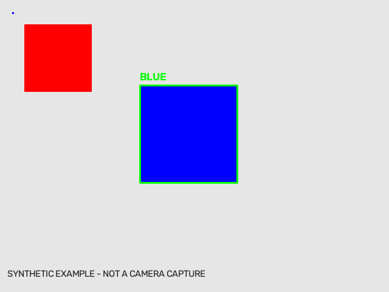

# OpenCV 기초 — 파란색 큐브 후보 검출

각 개념을 따로 확인하려면 [11개 독립 예제·상세 주석·venv 설치 안내](step_tests/README.md)를 사용한다.

파란색 기준 파일은 `blue_cube_reference.py`다. 편집 중인 `blue_cube.py`는 그대로 보존한다.

16강 OpenCV 기초에서 영상을 다루는 흐름을 익히고, 19강 HSV·Contour 검출로 연결하는 예제다. Intel RealSense D435i의 **컬러 영상**에서 파란 영역을 찾고 **초록색 바운딩 박스**를 표시한다.

## 실행

카메라를 연결한 **화면이 있는 PC의 데스크톱 터미널**에서 실행한다. OpenCR·모터 제어는 포함하지 않는다. 일반 SSH 터미널만으로는 `imshow` 창이 표시되지 않는다.

기존 설치 가이드로 RealSense SDK·Python 바인딩을 준비한 환경을 사용한다. GUI용 `opencv-python`을 사용하며 `opencv-python-headless`와 중복 설치하지 않는다.

```bash
python3 -m venv .venv
source .venv/bin/activate
python -m pip install numpy opencv-python pyrealsense2
python blue_cube_reference.py
```

위 설치 명령은 PC용이다. 해당 Python/아키텍처에 `pyrealsense2` wheel이 없으면 기존 RealSense 설치 가이드의 SDK 바인딩 설치 절차를 따른다.

일반 USB 웹캠으로 같은 OpenCV 처리 과정을 확인할 수도 있다.

```bash
python blue_cube_reference.py --webcam 0
```

`Blue cube - green box`에는 검출 결과, `Blue mask`에는 이진 마스크가 표시된다. 창을 선택하고 `q` 또는 `Esc`를 누르면 종료한다. RealSense Viewer나 다른 프로그램이 카메라를 점유하고 있으면 먼저 종료한다.

## 처리 순서

| 단계 | 함수 | 의미 |
|---|---|---|
| 컬러 영상 읽기 | `get_color_frame` | D435i RGB 영상을 BGR 배열로 받는다. |
| HSV 변환 | `cvtColor` | 색상 H와 채도 S, 밝기 V로 분리한다. |
| 파란색 선택 | `inRange` | 범위 안의 픽셀은 흰색, 나머지는 검은색이다. |
| 잡음 제거 | `morphologyEx` | 작은 점을 없애고 작은 구멍을 메운다. |
| 윤곽선 검출 | `findContours` | 연결된 파란 영역의 외곽선을 구한다. |
| 박스 그리기 | `boundingRect`, `rectangle` | `(x,y,w,h)`를 구하고 BGR `(0,255,0)`으로 표시한다. |

## 조정할 값

- `LOWER_BLUE=[95,80,50]`, `UPPER_BLUE=[130,255,255]`: 시작 범위다. OpenCV의 H 범위는 0~179다. 조명과 실제 큐브 색에 맞게 조정한다.
- `MIN_AREA=500`: 너무 작은 잡음을 제외한다. 먼 큐브가 사라지면 낮추되 잡음 증가를 확인한다.
- 마스크에서 큐브가 검게 보이면 HSV 범위를 확인한다. 큐브는 흰색으로 남아야 한다.

색만으로 후보를 검출하므로 파란 배경·책·옷도 박스로 표시될 수 있다. **3D 큐브 형태를 인식하거나 깊이·자세를 추정하는 예제는 아니다.** 기초 단계에서는 다른 파란 물체가 없는 배경에서 확인한다.

## 카메라 없는 검증

```bash
python verify_blue_cube_reference.py
```



합성 파란 사각형 검출, 빨간 물체 제외, 작은 점 제거, 빈 화면 비검출, 초록색 박스 표시를 검사한다. 실제 D435i 영상의 HSV 범위는 현장에서 별도로 조정한다.

## 공식 참고

- [RealSense Python OpenCV 예제](https://github.com/realsenseai/librealsense/blob/master/wrappers/python/examples/opencv_viewer_example.py)
- [OpenCV 윤곽선](https://docs.opencv.org/4.x/d4/d73/tutorial_py_contours_begin.html)
- [OpenCV HSV 범위 선택](https://docs.opencv.org/4.x/df/d9d/tutorial_py_colorspaces.html)
